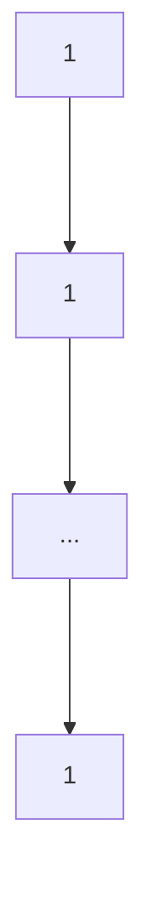
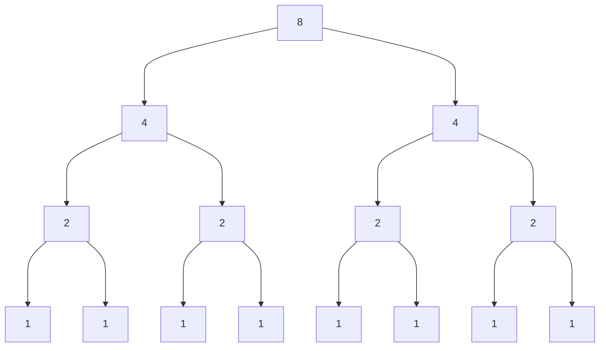

```table-of-contents
```

# Definition

Let $T(n)$ be the running time of some function on an input of size $n$. Then $T(n) \in \Theta(f(n))$ if there are constants $c_1, c_2 > 0$ and $N \in n$ such that, $\forall n \in \mathbb{N}$, 

$$
n \ge N \implies c_1 f(n) \le T(n) \le c_2 f(n)
$$

Consider, the function

```python
# Pre: n is a nonnegative integer
def factorial(n):
	if n == 0:
		return 1
	else:
		return n * factorial(n - 1)
```

We assume all arithmetic operations take constant time $\Theta(1)$.

Then, we have the following running time function:

$$
T(n) = \begin{cases}
1 & n = 0 \\
1 + 1 + 1 + T(n-1)& n \ge 1
\end{cases}
$$

with the following running time tree. This tree counts the number of steps besides the recursive call at each step.



# Merge Sort

Now, consider 

```python
# Pre: A is a list of comparable elements
def merge_sort(A):
	n = len(A) # O(1)
	if n <= 1: # O(1)
		return A[:] # O(1)
	L = A[:n // 2] # O(floor(n/2))
	R = A[n // 2:] # O(ceil(n/2))
	LS = merge_sort(L) # T(floor(n/2))
	RS = merge_sort(R) # T(ceil(n/2))
	return merge(LS, RS) # O(n)
```

Then

$$
T(n) = \begin{cases}
1 & n \le 1 \\
T(\lfloor n/2 \rfloor) + T(\lceil n/2 \rceil)+ n& n > 1
\end{cases}
$$

We have the following running time tree for $n = 8$:



Summing up the values, we get a total running time of $T(8) = 32$.

In general, if we have $n = 2^k$, notice how each level in the tree sums up to $n$ and there are $\log_2(n) + 1 = k + 1$ levels. Thus, we have

$$
T(n) = n(\log_2(n) + 1)
$$

In general, for asymptotic runtimes, we can ignore ceilings and floors. For example, for merge sort, we can let $\hat n$ be the smallest power of $2$ that is greater than or equal to $n$. Then, for $n \le 1$, we have $n \le \hat n < 2n$. Thus,

$$
\begin{align*}
T(n) &\le T(\hat n) \\
&= (1 + \log(\hat n))\hat n \\
&\ge (1 + \log(2n))2n \\
&= (2 + \log(n))2n \\
&\in O(n \log(n))
\end{align*}
$$

You can use a similar argument to show that $T(n) \in \Omega(n \log(n))$.

# Multiplication

## Standard Recursive Algorithm

Consider the following algorithm that multiplies two numbers.

```python
# Pre: x and y are nonnegative integers
def product(x, y):
	n = max(len(str(x)), len(str(y))) # O(1)
	if n <= 1: # O(1)
		return x * y # O(1), only because these are 1 digit numbers
	m = n // 2 # O(1)
	a, b = x // (10 ** m), x % (10 ** m) # O(n)
	c, d = y // (10 ** m), y % (10 ** m) # O(n)
	ac = product(a, c) # T(n/2)
	bd = product(b, d) # T(n/2)
	ad = product(a, d) # T(n/2)
	bc = product(b, c) # T(n/2)
	
	# Multiplying by 10^k takes O(k) since we just add k zeroes
	#      O(2m) = O(n)         O(m) = O(n)             O(1)  
  	return 10 ** (2 * m) * ac + (10 ** m) * (ad + bc) + bd
```

This "pads" each number to the same length, and then breaks each number into two (e.g. $x = ab$ where $a$ and $b$ are concatenated like strings). Then it computes

$$
(10^m a + b)(10^m c + d) = 10^{2m}ac + 10^m(ad + bc) + bd   
$$

We have the following running time recurrence

$$
T(n) = \begin{cases}
1 & n \le 1 \\
4T(n/2) + n & n > 1
\end{cases}
$$

If we draw out the running time tree, we have $1$ node with time $n$, $4$ with time $n/2$, $16$ with time $n/4$, so on and so forth. Then, for a level $h$, we have a total running time for that level of $2^hn$. And we have $\log_2(n) + 1$ levels.

So we have a total running time of

$$
\begin{align*}
T(n)&= n + 2n + 4n + \ldots + 2^{\log_2(n)} n  \\
&= n(1 + 2 + 4 + 8+ \cdots 2^{\log_2(n)}) \\
&= n(1 + 2 + 4 + 8+ \cdots n) \\
&= n \left(\dfrac{(1)(1 - 2^{\log_2(n) + 1})}{1 - 2}\right) \\
&= n \left(\dfrac{1 - 2n}{1 - 2}\right) \\
&= n(2n-1) \\
&= 2n^2 - n \\
&= \Theta(n^2)
\end{align*} 
$$

## Karatsuba's Algorithm

Now, consider another algorithm for multiplication

```python
# Pre: x and y are nonnegative integers
def karatsuba(x, y):
	n = max(len(str(x)), len(str(y))) # O(1)
	if n <= 1: # O(1)
		return x * y # O(1), only because these are 1 digit numbers
	m = n // 2 # O(1)
	a, b = x // (10 ** m), x % (10 ** m) # O(n)
	c, d = y // (10 ** m), y % (10 ** m) # O(n)
	ac = karatsuba(a, c) # T(n/2)
	bd = karatsuba(b, d) # T(n/2)
	z = karatsuba(a + b, c + d) # T(n/2), since n/2 digits + n/2 digits is roughly n/2 digits
	# Multiplying by 10^k takes O(k) since we just add k zeroes
	#      O(2m) = O(n)         O(m) = O(n)             O(1)  
  	return 10 ** (2 * m) * ac + (10 ** m) * (z - ac - bd) + bd
```

This simply computes $ad + bc$ as $(a + b)(c + d) - ac - bd$, Since we already have $ac$ and $bd$, we only need **one multiplication** of $(a + b)(c + d)$ to get $ad$ and $bc$.

We have the running time relation as

$$
T(n) = \begin{cases}
1 & n \le 1 \\
3T(n/2) + n & n > 1
\end{cases}
$$

Consider the running time tree where $n = 2^h$ for some $h \in \mathbb{N}$, we only have three children per node, so at a level $i$, we have a total running time for that level of $(3/2)^i n$. We have $\log_2(n) = h$ levels, so we have a total running time of 

$$
\begin{align*}
T(n)&=\sum_{i = 0}^{k} \left(\dfrac{3}{2}\right)^i n \\
&= \dfrac{n\left(1 - \left(\dfrac{3}{2}\right)^{h + 1}\right)}{1 - \dfrac{3}{2}}\\
&= 2n\left(\left(\dfrac{3}{2}\right)^{h + 1} - 1\right)  \\
&= 2n\left(\left(\dfrac{3}{2}\right)^{\log_2(n) + 1} - 1\right)  \\
&= 2n\left(2 ^{\log_2\left(\tfrac{3}{2}\right)^{\log_2(n) + 1}} - 1\right)  \\
&= 2n\left(2 ^{(\log_2(n) + 1)\log_2\left(\tfrac{3}{2}\right)} - 1\right)  \\
&\approx 2n\left(2 ^{\log_2(n)\log_2\left(\tfrac{3}{2}\right)} - 1\right)  \\
&\approx 2n\left(n^{\log_2\left(3\right) - 1} - 1\right)  \\
&\approx 2n^{1+\log_2\left(3\right) - 1}   \\
&\approx 2n^{\log_2(3)}   \\
&=\Theta(n^{\log_2(3)})
\end{align*}
$$

# The Master Theorem

Suppose $f$ is a recursive algorithm that

1. Makes $a \in \mathbb{N}^+$ recursive calls, each on input of size $n/b$, where $b > 1$.
2. Does $\Theta(n^d)$ work outside the recursive calls, where $d \ge 0$.

The recursive for the runtime is

$$
T(n) = \begin{cases}
n^d + aT(n/b) & n > 1\\
1 & n = 1
\end{cases}
$$

Drawing the running time tree out, we start with one node with non-recursive work $n^d$. Each node has $a$ children and, since it is called with size $n/b$, have non-recursive work $(n/b)^d$. This repeats until we reach the base case. Thus, we have the following running time per level:

1. Level $0$: $n$
2. Level $1$: $a(n/b)^d$
3. Level $2$: $a^2(n/b^2)^d$
4….

So at each level $i$, we have a running time per level $a^i (n/b^i)^d$. We also have $\log_b(n)$ levels. At the last level, we have running time

$$
a^{\log_b(n)}\left(\dfrac{n}{b^{\log_b(n)}}\right)^d = a^{\log_b(n)}
$$

Therefore, we have

$$
\begin{align*}
T(n) &= \sum_{i = 0}^{\log_b(n)} a^i\left(\dfrac{n}{b^i}\right)^d \\
&= \sum_{i = 0}^{\log_b(n)} a^i\left(\dfrac{n^d}{(b^d)^i}\right) \\
&= \sum_{i = 0}^{\log_b(n)} \left(\dfrac{a}{b^d}\right)^i n^d \\
&= n^d \sum_{i = 0}^{\log_b(n)} \left(\dfrac{a}{b^d}\right)^i \\
\end{align*} 
$$

We have the following facts for geometric series. Let $r > 0$ be constant and let $k \ge 0$ be an integer. For $r \ne 1$,

$$
\sum_{i=0}^k r^h = 1 + r + r^2 + \cdots + r^k = \dfrac{r^{k+1}}{r - 1}
$$

- If $0 < r < 1$, the sum is bounded between $1$ and $1 / (1 - r)$, so it is $\Theta(1)$.
- If $r = 1$, each term is $1$ so the sum is $k + 1 = \Theta(k)$ as $k \to \infty$.
- If $r > 0$, the sum is dominated by the last term and is $\Theta(r^k)$.

Then, if $a/b^d < 1$, then

$$
\sum_{i = 0}^{\log_b(n)} \left(\dfrac{a}{b^d}\right)^i = \Theta(1) \implies  T(n) = \Theta(n^d)
$$

If $a/b^d = 1$, then 

$$
\sum_{i = 0}^{\log_b(n)} \left(\dfrac{a}{b^d}\right)^i = \Theta(\log_b(n)) \implies  T(n) = \Theta(n^d \log_b(n))
$$

If $a/b^d > 1$, then

$$
\begin{align*}
\sum_{i = 0}^{\log_b(n)} \left(\dfrac{a}{b^d}\right)^i &= \Theta\left(\left(\dfrac{a}{b^d}\right)^{\log_b(n)}\right) \\
&= \Theta\left(\dfrac{a^{\log_b(n)}}{n^d}\right) \\
&= \Theta\left(\dfrac{b^{\log_b(a^{\log_b(n)})}}{n^d}\right)\\
&= \Theta\left(\dfrac{b^{\log_b(n)\log_b(a)}}{n^d}\right)\\
&= \Theta\left(\dfrac{n^{\log_b(a)}}{n^d}\right)\\
&\implies  T(n) = \Theta(n^{\log_b(a)})
\end{align*}
$$

> [!NOTE] Theorem: The Master Theorem
> Suppose $T(n) = aT(n/b) + n^d$ where $a \in \mathbb{N}^+$, $b > 1$, and $d \ge 0$ are all constants. If
> 
> 1. $b^d < a$, then it's bottom heavy and $T(n) = \Theta(n^{\log_b(a)})$.
> 2. $b^d = a$, then it's balanced and $T(n) = \Theta(n^d \log_b(n))$.
> 3. $b^d > a$, then it's top heavy and $T(n) = \Theta(n^d)$.
